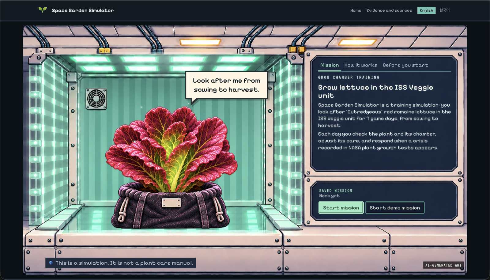
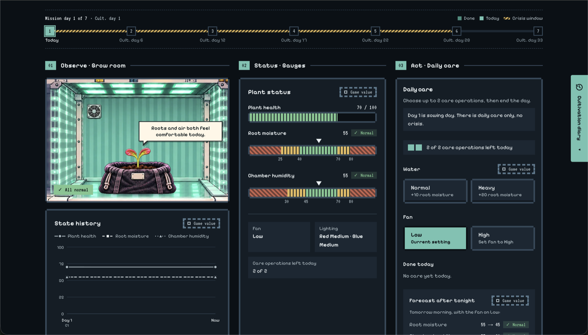
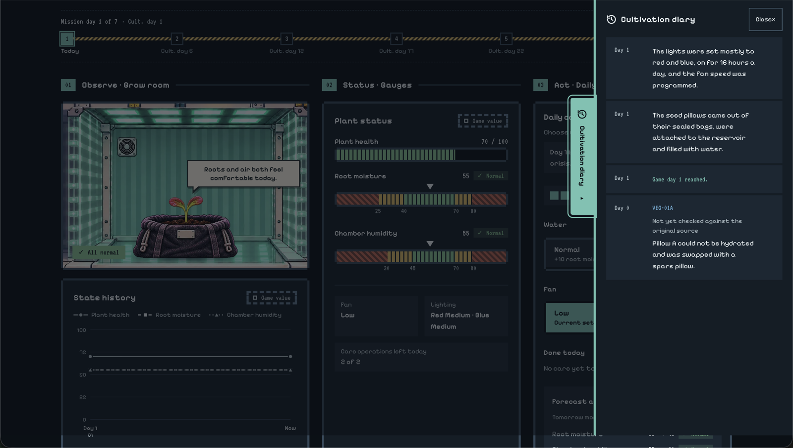
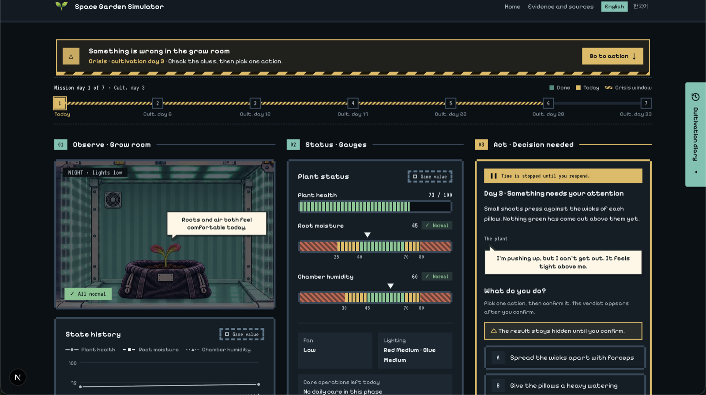
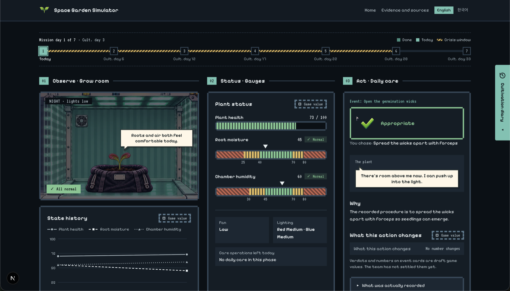
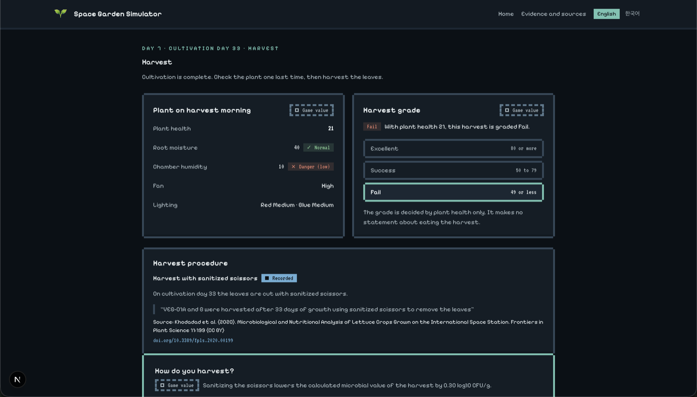
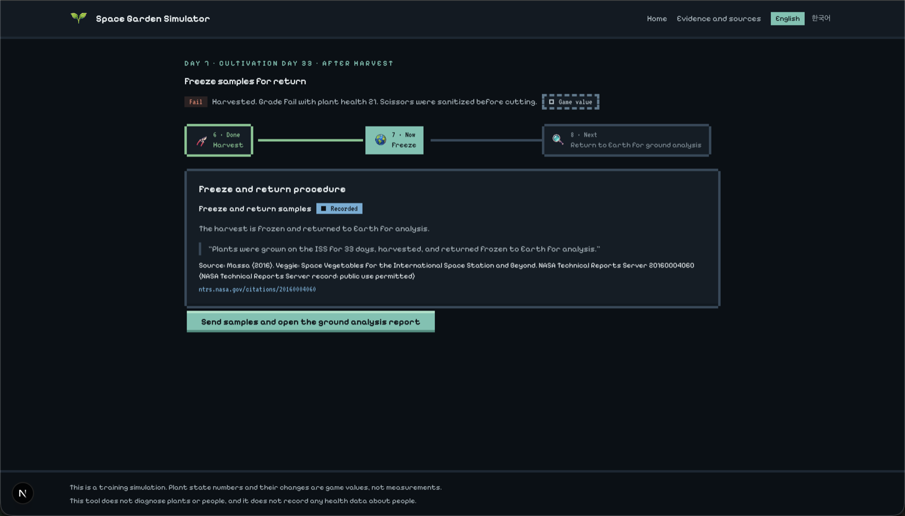
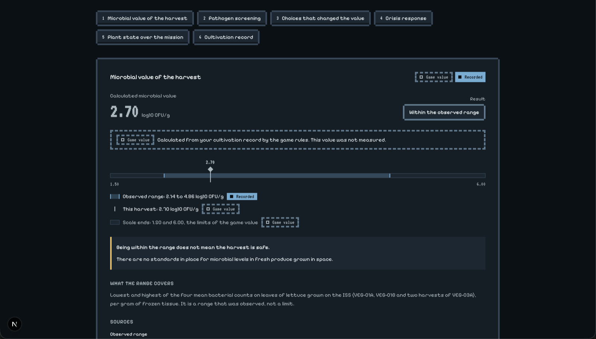

# Hothis Groot Gardner

**Live:** https://hothis-groot-gardener.vercel.app/ (no login)

## Quick start

> [!IMPORTANT]
> **Web app.** Needs Node.js 20.9 or later and npm. No account, database or `.env` file is needed.
>
> ```bash
> npm install                  # from the repository root
> npm run dev                  # development server, http://localhost:3000
> npm run build && npm start   # production build, http://localhost:3000
> npm run check                # typecheck, lint, tests, build
> ```
>
> **Cultivation timeline** (off by default, on at the live link). Add this line to `apps/web/.env.local`, then restart `npm run dev` or build again:
>
> ```dotenv
> NEXT_PUBLIC_TIMELINE=1
> ```
>
> It is read at build time. Only new missions use it; a saved mission keeps the mode it started with.
>
> **Language model (optional).** One script installs [Ollama](https://ollama.com) if it is missing (it asks first), downloads `gemma4:e4b` once (about 10 GB), writes `apps/web/.env.local`, then builds and starts the app at http://localhost:3000.
>
> ```bash
> bash scripts/start-with-ai.sh
> ```
>
> ```powershell
> powershell -ExecutionPolicy Bypass -File scripts\start-with-ai.ps1
> ```
>
> Wait for `[llm] gemma4:e4b is loaded` in the terminal. A reply that takes longer than the limit (30 seconds per attempt, two attempts) is replaced by the pre-made text; a GPU is recommended ([docs/DEVELOPMENT.md](docs/DEVELOPMENT.md)). Options: `--yes` / `-Yes`, `--dev` / `-Dev`, `--port 3001` / `-Port 3001`. Without the script: run `ollama pull gemma4:e4b` and copy `apps/web/.env.example` to `apps/web/.env.local`. To run without the model again, delete `apps/web/.env.local`.
>
> **Evidence search (optional).** Keyword search over excerpts from published plant research papers (listed in [docs/SOURCES.md](docs/SOURCES.md)), added to the model's prompt. It needs [uv](https://docs.astral.sh/uv/) and no API key. The script above does not start it.
>
> ```bash
> cd services/rag
> uv sync --group server
> uv run uvicorn rag_server:app --host 127.0.0.1 --port 8000
> ```
>
> Then set `RAG_URL=http://127.0.0.1:8000` in `apps/web/.env.local`.
>
> **Settings** in `apps/web/.env.local`. All are optional; `apps/web/.env.example` lists every one with comments.
>
> | Variable | Effect |
> |---|---|
> | `NEXT_PUBLIC_TIMELINE` | `1` or `true` turns the cultivation timeline on (build time) |
> | `LLM_MODEL` | Model name, e.g. `gemma4:e4b`. Unset: no model, every crisis uses pre-made text |
> | `LLM_PROVIDER`, `LLM_BASE_URL`, `LLM_API_KEY` | `ollama` (default, `http://127.0.0.1:11434`) or `openai` for any OpenAI-compatible server, with its URL ending in `/v1` and a key if it needs one |
> | `LLM_TIMEOUT_MS` | Limit per attempt in ms (default 30000); after two attempts the pre-made text is shown |
> | `LLM_KEEP_ALIVE` | How long Ollama keeps the model loaded (default `30m`, `-1` = always) |
> | `LLM_EVENT_CARDS` | `on` lets the model also write the timeline event cards (needs `LLM_MODEL`) |
> | `RAG_URL` | Evidence search server. Unset: search off |
>
> Copying `.env.example` unchanged turns on both the model and `RAG_URL`. If no search server answers within 3 seconds, the model writes without excerpts.

**Space Garden Simulator** is a web training simulation: you look after 'Outredgeous' red romaine lettuce in the ISS Veggie unit for 7 game days, from sowing to harvest.

NASA Space Apps Challenge 2026 · *Create Health Monitoring Software for Astronauts on Space Missions* · Team Hothis

The 7 game days cover cultivation days 1 to 33. The app does not record any health data about people.

## What is implemented

| Step | What the app does |
|---|---|
| Check | Gauges for plant health, root moisture, chamber humidity, fan and lighting, and a history chart. Lighting is shown, not set. |
| Care | Up to 2 care operations a day: water (+10 or +20 root moisture) or fan (Low, High). |
| Crisis | "Water shortage", or "Excess water and stagnant air leading to mold". 4 actions to choose from, 3 when asked again. |
| Decide | The result shows a verdict, "Why", "Basis for the verdict" and "What changed". The source quote and link are in sections you open. |
| Harvest | Day 7: harvest with or without sanitized scissors, freeze samples, read the "Ground analysis report". |

- The mold crisis record is from zinnia grown in the same Veggie hardware. The crisis screen says: "This record is from zinnia, not lettuce."
- The report compares a calculated microbial value with an observed range on ISS-grown lettuce (2.14 to 4.86 log10 CFU/g). It says: "Being within the range does not mean the harvest is safe."
- Cards with state numbers or source statements are tagged "Recorded" (from the cited source) or "Game value" (set by the team, not a NASA value). `/sources` lists the evidence and game rules.
- English and Korean. The mission is saved in the browser.

| | On the live link | Default build from this repository |
|---|---|---|
| Cultivation timeline, cultivation diary, event cards | On | Off (`NEXT_PUBLIC_TIMELINE=1` turns them on at build time) |
| At least two crises per standard mission | Applies | Applies |
| Language model | None (pre-made text) | None unless `LLM_MODEL` is set |

Event cards say on screen that their verdicts and numbers are draft game values.

## NASA data used

| Source | What the app takes from it |
|---|---|
| [Massa, Dufour and Smith (2014), *Veggie Hardware Validation Test*, NTRS 20150001374](https://ntrs.nasa.gov/citations/20150001374) | Water shortage crisis: record, symptoms, the corrective action |
| [NASA (2017), *On-Orbit Gardening Guides*, NTRS 20170007815](https://ntrs.nasa.gov/citations/20170007815) | Fan settings and what the high setting does; watering by observation |
| [Massa (2016), *Veggie: Space Vegetables for the International Space Station and Beyond*, NTRS 20160004060](https://ntrs.nasa.gov/citations/20160004060) | Harvest frozen and returned to Earth for analysis; the crop of the VEG-01 test |
| [NASA, *Growing Plants in Space*](https://www.nasa.gov/exploration-research-and-technology/growing-plants-in-space/) | Excess water and mold crisis: record, the cleaning action |
| NASA OSDR [OSD-358](https://osdr.nasa.gov/bio/repo/data/studies/OSD-358) and [OSD-177](https://osdr.nasa.gov/bio/repo/data/studies/OSD-177) | Fungal growth on zinnia leaves and stems; rot disease on the zinnia plants |
| [Khodadad et al. (2020), *Frontiers in Plant Science* 11:199](https://doi.org/10.3389/fpls.2020.00199) | Bacterial count range on ISS-grown lettuce leaves, pathogen screening results, absence of standards, harvest and freezing steps |
| [NASA (2021), *Researchers Put Space Garden Microbes Under the Microscope*](https://www.nasa.gov/missions/station/researchers-put-space-garden-microbes-under-the-microscope/) | Background: contaminated plant systems can make crops fail |
| [NASA Human Research Program (2025), *Evidence Report: Risk of Adverse Cognitive or Behavioral Changes and Psychiatric Disorders …*](https://humanresearchroadmap.nasa.gov/evidence/reports/HRP-ER-BMED-HFBP-20250210.pdf) | Background: failing crops and crew well-being |
| [Landon et al. (2025), *Behavioral Health Benefits of the ISS Pick-and-Eat Crop Growth System*, NTRS 20250000411](https://ntrs.nasa.gov/citations/20250000411) | Background: working with plants as a behavioral health countermeasure |

Every quote in the evidence list was compared by a script with the text of the downloaded source document and is a verbatim part of it. All state values and their changes are game values set by the team.

## Screenshots

| | |
|---|---|
|  Start |  Mission day |
|  Cultivation diary |  Event |
|  Event result |  Harvest |
|  Freeze |  Report |

The screenshots show the app with the cultivation timeline on, as on the live link.

The plant and chamber art in the screenshots is AI-generated.

## Data and checks

Commands and settings are in [Quick start](#quick-start). `npm run check` runs TypeScript (`tsc --noEmit`), ESLint, Vitest (**812 tests in 48 files**), and `next build`.

The evidence list, pre-made crisis text and timeline events are JSON files in `data/content/`. Model, search and code structure: [docs/DEVELOPMENT.md](docs/DEVELOPMENT.md).

## Frontend engineering and quality highlights

| Area | Artifact | Summary |
|---|---|---|
| Architecture & tradeoffs | [docs/adr/0001-frontend-architecture.md](docs/adr/0001-frontend-architecture.md) | `useSyncExternalStore` + frozen `SERVER_SNAPSHOT`, `import 'server-only'` + 64 KiB streaming body cap + Zod `strictObject`, Tailwind v4 `@theme`/`@container` + CVA, deterministic engine vs optional LLM boundary |
| Accessibility, overflow & CWV audit | [docs/QUALITY-AUDIT.md](docs/QUALITY-AUDIT.md) | Local production build (`next start`) + Headless Chromium lab audit (not RUM): 375px KO overflow `+11 px → 0 px`, `axe-core` WCAG 2.2 AA `3 serious rules → 0 violations`, unused `public/bg` `-74%` (4.7 → 1.2 MB) |
| OWASP security headers | [apps/web/next.config.ts](apps/web/next.config.ts) | CSP (no `unsafe-eval` in prod), `X-Frame-Options: DENY`, `X-Content-Type-Options: nosniff`, `Referrer-Policy`, `Permissions-Policy`, HSTS, `poweredByHeader: false` |
| CI guardrails | [.github/workflows/ci.yml](.github/workflows/ci.yml) | Runs `npm run check`, route + security-header smoke checks, `npm audit --omit=dev --audit-level=high`, and Lighthouse CI accessibility/CWV checks |
| AI collaboration rules | [AGENTS.md](AGENTS.md) | Repository boundaries, human vs AI delegation split, and mandatory verification checklist |

## Team contributors and ownership

Commit counts reflect `git shortlog -sn` history so individual and collaborative boundaries stay transparent:

| Contributor | Primary Ownership | Repository Evidence |
|---|---|---|
| **sunub** | Frontend architecture, SG-DS v2 pixel design system (`tokens.css`, `utilities.css`, `components/ui`), grow-room & report UI, WCAG 2.2 AA accessibility, Korean i18n, security headers, CI & quality audit | `apps/web/src`: 73/95 commits prior to this audit (`features`/`components`/`styles`: 58/66 commits) |
| **HwangSoon96** | Game engine rules & minimum-crisis invariant, planning-spec reconciliation (`docs/IMPLEMENTATION-NOTES.*`), documentation fact-checking, independent reviews & seed tests | 63 total commits across engine, tests, evidence & docs |
| **김우진 (W.J.Kim)** | Evidence search server (`services/rag`), retrieval evaluation (`data/eval/`), local LLM integration & one-step launch scripts (`scripts/start-with-ai.*`) | 18 combined commits (`김우진` 14, `W.J.Kim` 4) |
| **Spice7** | Cultivation timeline engine integration (`NEXT_PUBLIC_TIMELINE`, `events` schema/judge, `docs/TIMELINE-ENGINE-NOTES.md`) | 6 commits across timeline schema, judge & storage v2 |
| **KIMMINJUNG02** | NASA RAG source chunk curation & Chroma vector database build (`data/sources/`, `data/vector_db/`) | 6 commits across RAG corpus & vector index |
| **변은아** | Landing grow-room scene implementation (landing concept v0.6.3) | Landing scene commit (`73b61d5`) |

## Not built and known limits

Items 2 to 9 were originally found on a default build at commit `b5662b8` and updated after the verification pass in [docs/QUALITY-AUDIT.md](docs/QUALITY-AUDIT.md).

1. The third crisis (ethylene build-up) is not built.
2. After 2 inappropriate choices, ground control ends the crisis. The notice does not say that the watched items return to 55.
3. The hint says you will be asked again, also on the second ask, after which the crisis ends.
4. "Why" and "Basis for the verdict" can be the same sentence.
5. In Korean, crisis names on the result screen and report, source quotes and notes stay English.
6. Switching language during a crisis leaves that crisis's text in the earlier language.
7. The microbial value counts only humidity, the mold crisis, cleaning and sanitizing.
8. ~~In Korean, pages overflow by 11px at 375px width~~ — **Fixed** (wrapped `<header>` nav in `app-shell.tsx`; verified `0 px` overflow across `/`, `/mission`, `/sources`, and `/design-system` at `375×812` in Headless Chromium; see [docs/QUALITY-AUDIT.md](docs/QUALITY-AUDIT.md)).
9. Tags are per card or section, and some numbers have no tag.
10. With the local model at commit `e485a17` on the development laptop (`LLM_TIMEOUT_MS=60000`), English crises took 39.6 to 120.3 s to appear.
11. Tested in Headless Chromium only (local production build, not RUM). Not tested on physical phones, Safari or Firefox.
12. On returning Korean visits (`localStorage` locale `ko`), static prerendered HTML hydrates in English before switching to Korean + lazy `Hahmlet` font chunks, producing a lab CLS of `0.272` on `/sources` at `375×812` (see [ADR-0001](docs/adr/0001-frontend-architecture.md)).

## Use of AI tools

| Tool | Used for |
|---|---|
| Gemma 4 E4B (Google), run through Ollama | In the app, optional: writes crisis text and translates crisis text and diary lines into Korean when `LLM_MODEL` is set. Not on the live link. |
| Claude (Anthropic), including Claude Code | Writing and testing code; searching the downloaded NASA documents; drafts of the evidence list, the pre-made crisis text, the documents and this README. |
| Codex (OpenAI, model recorded as GPT-6) | The search service: its chunk files and the vector database build script. |
| OpenAI `text-embedding-3-small` | Building the vector database of the optional evidence search. |
| Image generation tool (not recorded in this repository) | The plant and chamber art in the app. The start screen labels it "AI-GENERATED ART". |

The model never sets verdicts, state changes or sources: they come from the evidence list. Per-file notes on AI use are in the `ai_disclosure` fields of `data/content/` and in [docs/SOURCES.md](docs/SOURCES.md#6-ai-tools).

## License

The team's code and the text the team wrote are under the [Apache License 2.0](LICENSE). NASA documents, published papers, fonts and packages keep their own terms, listed in [docs/SOURCES.md](docs/SOURCES.md).

The search excerpts in `data/sources/total_RAG.json`, `data/json/`, `data/json_ko/`, `data/vector_db/` and `vector_db/` include text from papers that are not openly licensed, and are not covered by the Apache license. Of the 76 excerpts, 20 are under CC BY 4.0, 41 under CC BY-NC-ND 4.0, and 15 have no open license.
